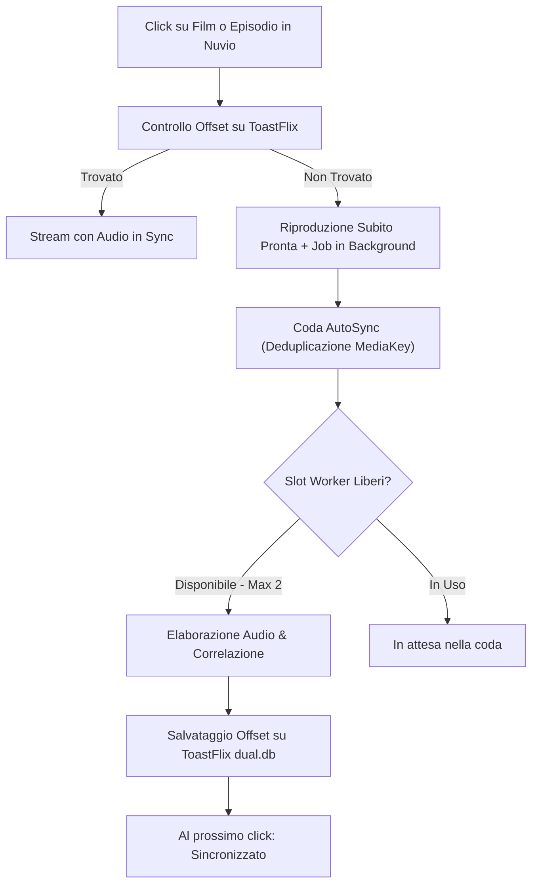

# PriSynx Suite

Suite di plugin per **Nuvio** e **NuvioTV** per lo streaming in lingua italiana e internazionale, con supporto ad auto-delay audio, multi-qualità (fino a 4K) e sorgenti dirette.

---

## ☁️ CloudStream

Repository da aggiungere in CloudStream (*Impostazioni → Estensioni → Aggiungi repository*):

```
https://raw.githubusercontent.com/qwertyuiop8899/prisynx_cs3/main/main.json
```

### 🧩 PriSynx (hub)
Un'unica estensione che interroga in parallelo tutte le sorgenti (tranne RaiPlay, che resta separata) e mostra i link nell'ordine scelto.
Dal pulsante ⚙️ dell'estensione (*Estensioni → PriSynx → impostazioni*) si apre un menu per:

* **Provider**: attivare/disattivare ogni sorgente e cambiarne l'ordine (▲/▼). I link vengono inviati al player in quest'ordine.
* **Cataloghi TMDB**: scegliere quali liste mostrare in home (Tendenze, Film/Serie popolari, Più votati, Al cinema, In arrivo, In onda).
* **TopX**: mostrare/nascondere i cataloghi TopX (anche singolarmente), metterli prima o dopo quelli TMDB e cambiare l'URL del manifest TopX.

Le 17 estensioni singole restano disponibili (ognuna con home e ricerca proprie).

### ▶️ VidxGo
Nuova sorgente (film e serie, basata su IMDb) con stream HLS fino a 4K. I token del CDN scadono dopo pochi minuti: l'estensione li rinnova automaticamente durante la riproduzione.

### 🔧 Build
I sorgenti Kotlin sono in questo branch (`shared/` + un modulo per provider). A ogni push su `main` la GitHub Action compila i `.cs3` e li pubblica nel branch `builds`, da cui CloudStream li scarica.

---

## 📺 Provider Disponibili (14 Sorgenti)

| Icona | Provider | Contenuti | Risoluzione & Formato | Audio / Sottotitoli | Note & Caratteristiche |
| :---: | :--- | :--- | :--- | :--- | :--- |
| ⚡ | **DualSync** | Film & Serie TV | 4K / 1080p · HLS | 🇮🇹 Audio ITA + 🌐 Originale | Video Cinejoy/Vidfast con mux audio ITA e AutoSync delay |
| 🎬 | **MovyITA** | Film & Serie TV | 1080p · HLS | 🇮🇹 Audio ITA + 🌐 Originale | Flusso Movy con doppia traccia audio sincronizzata |
| 🏰 | **Altadefinizione** | Film & Serie TV | 1080p / 720p · MP4 | 🇮🇹 Audio ITA | CDN MP4 diretta ad alta velocità |
| 🎞️ | **Guardoserie** | Serie TV | 1080p / 720p · HLS / MP4 | 🇮🇹 Audio ITA + Sub-ITA | Player Uqload, Abyss (mloadm) e Loadm |
| 📺 | **CB01** | Film & Serie TV | 1080p / 720p · MP4 / HLS | 🇮🇹 Audio ITA + Sub-ITA | Risoluzione dinamica probe MP4 su MixDrop |
| 🍿 | **Eurostreaming** | Serie TV | 720p / 1080p · HLS / MP4 | 🇮🇹 Audio ITA + Sub-ITA | MixDrop, Turbovid, DeltaBit con captcha bypass automatico |
| 💎 | **VixSrc** | Film & Serie TV | 1080p / 720p · HLS | 🇮🇹 Audio ITA + Multi-audio + Sub | Streaming HLS con selezione tracce audio e sub |
| 🌐 | **PaCC** | Film & Serie TV | 1080p / 720p · HLS | 🇮🇹 Audio ITA + Sub-ITA | Multi-server HLS con traccia audio italiana |
| 🎨 | **Toonitalia** | Cartoni & Serie TV | 1080p / 720p · HLS / MP4 | 🇮🇹 Audio ITA + Sub-ITA | Cartoni animati, serie vintage e anime (VOE, Uqload) |
| 🍰 | **Real Time** | Canale TV / Reality | 1080p · HLS | 🇮🇹 Audio ITA | Programmi Discovery Italia ufficiali (solo stagioni online) |
| 🏛️ | **RaiPlay** | Fiction, Film & Doc | 1080p · HLS | 🇮🇹 Audio ITA | Catalogo RaiPlay ufficiale in alta definizione (DRM-free) |
| 🌸 | **AnimeWorld** | Anime | 1080p / 720p · MP4 | 🇮🇹 Doppiato + 🇯🇵 SUB-ITA | Link MP4 diretti veloci con mapping automatico |
| 🦊 | **AnimeSaturn** | Anime | 1080p / 720p · HLS / MP4 | 🇮🇹 Doppiato + 🇯🇵 SUB-ITA | StreamPeaker HLS/MP4 con mapping automatico |
| 🏮 | **AnimeUnity** | Anime | 1080p / 720p · HLS | 🇮🇹 Doppiato + 🇯🇵 SUB-ITA | Server VixCloud con bitrate elevato (ITA e SUB) |
| ▶️ | **VidxGo** | Film & Serie TV | 4K / 1080p · HLS | 🌐 Originale / Multi | Solo CloudStream · rinnovo automatico token |
| 🏴‍☠️ | **IlCorsaroViola** | Film & Serie TV | 4K / 1080p · Torrent | 🇮🇹 Audio ITA + Multi | Torrent P2P con seeders, formati HEVC/H.264 e bitrate calcolato |

---

## 🎯 Audio Delay Automatico & Manuale

Molti video 4K/FHD e audio ITA provengono da edizioni diverse (es. loghi iniziali o sigle di durata differente). PriSynx include l'offset millimetrico per allinearli.

### 📺 NuvioTV (Android TV / Google TV)
I plugin includono nei metadati dello stream:
```javascript
behaviorHints: {
  audioDelayMs: 1250 // Ritardo in millisecondi (fino a ±60s)
}
```
* **Con la PR [#3781](https://github.com/NuvioMedia/NuvioTV/pull/3781)**: NuvioTV applica il ritardo **automaticamente all'avvio**, senza premere alcun tasto sul telecomando.
* **Supporto NuvioTV**: ExoPlayer e mpv su Android TV supportano l'impostazione del delay audio.

### 📱 Impostazione Manuale (Nuvio Mobile / Finché la PR è in review)
1. Nella lista stream, leggi il valore nel badge (es. `⏱️ +1,25 s`).
2. Avvia la riproduzione.
3. Apri le opzioni audio del player (icona ⚙️ / altoparlante).
4. Imposta manualmente il ritardo indicato.

---

## ⚙️ Come Funziona l'Auto-Misurazione



### Regole di Funzionamento:
* **Trigger al click**: la misurazione **non parte durante la ricerca** nel catalogo, ma solo al click sul singolo episodio (quando vengono risolti gli stream reali).
* **Nessuna attesa**: il video è visibile e riproducibile subito; il calcolo avviene asincrono in background.
* **Coda (Max 2 Worker contemporanei)**: per non sovraccaricare la CPU, AutoSync gestisce massimo 2 elaborazioni parallele. Eventuali altri titoli attendono in coda.
* **Deduplicazione**: richieste multiple dello stesso episodio incrementano le priorità senza duplicare i calcoli.
* **Retry intelligente**: se un titolo era incompatibile nel vecchio database ToastFlix (es. vecchio fastpass), il plugin lo reinvia ad AutoSync per verificarlo con precisione a traccia intera.

---

## 🏷️ Significato dei Badge

| Badge | Significato | Azione |
| :--- | :--- | :--- |
| `⏱️ +X,XX s` | **Offset misurato** | Su NuvioTV si applica da solo; su mobile imposta il valore a mano. |
| `🔊✅ in sync` | **In perfetto sincrono** | Nessun ritardo necessario (< 100 ms). |
| `⏳ da misurare` | **Primo avvio** | Puoi guardare il video subito; calcolo avviato in background. |
| `⏳ in coda` | **In coda** | Coda momentaneamente piena (2 worker attivi); calcolo a breve. |
| `⚙️ in calcolo` | **Calcolo in corso** | Analisi attiva in questo momento (richiede 60–90s). Riapri tra poco. |
| `⛔ versioni diverse` | **Incompatibile** | Montaggi differenti o tagli interni verificati da AutoSync. |

---

## 📦 Installazione in Nuvio

Aggiungi i manifest nella sezione **Plugin** di Nuvio o NuvioTV:

### PriSynx (17 provider, incluso Il Corsaro Viola)
```text
https://raw.githubusercontent.com/qwertyuiop8899/PriSynx/nuvio/manifest.json
```

---

## 🤖 CloudStream (estensioni native)

Questo repository ospita anche le estensioni native **CloudStream** (Kotlin `.cs3`) che portano i provider del repository Nuvio/Stremio su CloudStream. I plugin Nuvio/Stremio (JavaScript) non sono caricabili da CloudStream: per questo ogni provider è stato riscritto come `MainAPI` Kotlin e pubblicato nel branch `builds`.

### Installazione in CloudStream

Aggiungi questo URL nella sezione **Impostazioni → Estensioni → Aggiungi repository**:

```text
https://raw.githubusercontent.com/qwertyuiop8899/PriSynx/main/main.json
```

CloudStream scaricherà l'elenco plugin da `plugins.json`. Ogni provider è ora una **estensione separata**, aggiornabile e disattivabile singolarmente:

`Altadefinizione`, `AnimeSaturn`, `AnimeUnity`, `AnimeWorld`, `CB01`, `IlCorsaroViola`, `DualSync`, `Eurostreaming`, `Filmez`, `Guardoserie`, `MovyITA`, `OnlineSerieTV`, `PaCC`, `RaiPlay`, `RealTime`, `Toonitalia`, `VixSrc`.

> ⚠️ **Geoblocking**: RaiPlay è disponibile solo da Italia/Europa. Fuori da queste aree il catalogo e i flussi HLS restituiscono errore/403.
>
> I contenuti con DRM (es. alcuni eventi sportivi) non sono supportati e vengono ignorati.

### Funzionalità CloudStream

| Funzione | Dettagli |
| :--- | :--- |
| 🏠 Home e ricerca | Catalogo e ricerca tramite TMDB (titoli italiani); **Real Time / NOVE / DMAX / Food Network** usano il catalogo nativo Discovery Aurora |
| 🎬 Film e serie | URL TMDB reali (`themoviedb.org/movie/ID`, `/tv/ID`) e URL nativi Discovery, risolti al click |
| ▶️ Streaming | HLS/MP4/Magnet tramite `ExtractorLink` nativi |
| 🇮🇹 Audio italiano | VixSrc, PaCC, anime, CB01/Eurostreaming (MaxStream/uprot), RaiPlay |
| ⚡ 4K + audio ITA | MovyITA e DualSync combinano video 4K con la traccia VixSrc in un master HLS servito su loopback locale |
| 🧩 Captcha uprot | Risoluzione automatica del captcha immagini tramite worker (Filmez, OnlineSerieTV, CB01, Eurostreaming) |
| 🏴‍☠️ Torrent | IlCorsaroViola tramite link Magnet |

**Note e limiti**

- CloudStream non supporta l'auto-sync audio di Nuvio: MovyITA/DualSync uniscono video e audio italiano in un unico master HLS, pubblicato su un mini-server HTTP di loopback (CloudStream non apre master `data:`); in caso di player esterno senza supporto HTTP locale viene mostrato anche il fallback “solo video”.
- I provider che usano `clicka.cc` (Eurostreaming/CB01) risolvono la sorgente MaxStream/uprot; i server MixDrop/Turbovid/DeltaBit dietro clicka non sono inclusi.
- Le pagine “cartella” di CB01/Eurostreaming non vengono seguite.
- Alcuni host (Filmez, OnlineSerieTV, CB01, Eurostreaming) possono richiedere il worker captcha e degradare se il servizio non è raggiungibile.

### Sviluppo e build

I moduli sono uno per provider: ogni cartella è un'estensione CloudStream indipendente (package `prisynx.providers`, RaiPlay in `prisynx.raiplay`). Il codice condiviso vive in `shared/`. Il repository segue la struttura ufficiale delle estensioni CloudStream:

```text
main.json                     # manifest repository per l'app
build.gradle.kts              # progetto Gradle root
settings.gradle.kts           # include automatico dei moduli (ogni cartella con build.gradle.kts)
shared/src/main/kotlin/prisynx/providers/
    core/TmdbProvider.kt      # home/search/load TMDB condiviso
    core/Uprot.kt             # captcha uprot + MaxStream
    core/Vix.kt               # master VixSrc e audio ITA
    core/AnimeMapping.kt      # mapping TMDB -> anime
    WpUprotProvider.kt        # pipeline WordPress + uprot (Filmez/OnlineSerieTV)
    Quadruple.kt              # helper condiviso
VixSrc/                       # un modulo = una estensione .cs3
  src/main/kotlin/prisynx/providers/
    VixSrcPlugin.kt           # @CloudstreamPlugin + registrazione del solo provider
    VixSrcProvider.kt         # home, search, load, loadLinks
AnimeSaturn/ ... (idem per ogni provider)
RaiPlay/
.github/workflows/cloudstream-build.yml
```

Build locale (richiede **JDK 17** e **Android SDK**):

```bash
./gradlew make makePluginsJson ensureJarCompatibility
```

Il workflow GitHub Actions compila a ogni push su `main` e pubblica `*.cs3`, `*.jar` e `plugins.json` sul branch `builds`.
