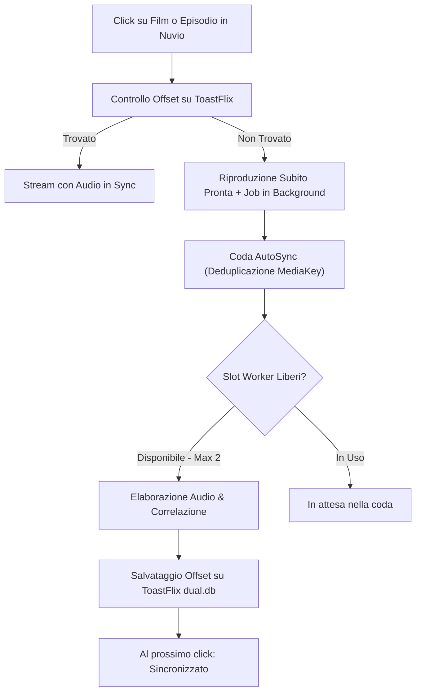

# PriSynx Suite

Suite di plugin per **Nuvio** e **NuvioTV** per lo streaming in lingua italiana e internazionale, con supporto ad auto-delay audio, multi-qualità (fino a 4K) e sorgenti dirette.

---

## 📺 Provider Disponibili (14 Sorgenti)

| Icona | Provider | Contenuti | Risoluzione & Formato | Audio / Sottotitoli | Note & Caratteristiche |
| :---: | :--- | :--- | :--- | :--- | :--- |
| ⚡ | **DualSync** | Film & Serie TV | 4K / 1080p · HLS | 🇮🇹 Audio ITA + 🌐 Originale | Video Cinejoy/Vidfast con mux audio ITA e AutoSync delay |
| 🎬 | **MovyITA** | Film & Serie TV | 1080p · HLS | 🇮🇹 Audio ITA + 🌐 Originale | Flusso Movy con doppia traccia audio sincronizzata |
| 🏰 | **Altadefinizione** | Film & Serie TV | 1080p / 720p · MP4 | 🇮🇹 Audio ITA | CDN MP4 diretta ad alta velocità |
| 🎞️ | **Guardoserie** | Serie TV | 1080p / 720p · HLS / MP4 | 🇮🇹 Audio ITA + Sub-ITA | Player Uqload, Abyss (mloadm) e Loadm |
| 📺 | **CB01** | Film & Serie TV | 1080p / 720p · MP4 / HLS | 🇮🇹 Audio ITA + Sub-ITA | Risoluzione dinamica probe MP4 su MixDrop |
| 🍿 | **Eurostreaming** | Serie TV | 720p / 1080p · HLS / MP4 | 🇮🇹 Audio ITA + Sub-ITA | MixDrop, Turbovid, DeltaBit con captcha bypass automatico |
| 💎 | **VixSrc** | Film & Serie TV | 1080p / 720p · HLS | 🇮🇹 Audio ITA + Multi-audio + Sub | Streaming HLS con selezione tracce audio e sub |
| 🌐 | **PaCC** | Film & Serie TV | 1080p / 720p · HLS | 🇮🇹 Audio ITA + Sub-ITA | Multi-server HLS con traccia audio italiana |
| 🎨 | **Toonitalia** | Cartoni & Serie TV | 1080p / 720p · HLS / MP4 | 🇮🇹 Audio ITA + Sub-ITA | Cartoni animati, serie vintage e anime (VOE, Uqload) |
| 🍰 | **Real Time** | Canale TV / Reality | 1080p · HLS | 🇮🇹 Audio ITA | Programmi Discovery Italia ufficiali (solo stagioni online) |
| 🏛️ | **RaiPlay** | Fiction, Film & Doc | 1080p · HLS | 🇮🇹 Audio ITA | Catalogo RaiPlay ufficiale in alta definizione (DRM-free) |
| 🌸 | **AnimeWorld** | Anime | 1080p / 720p · MP4 | 🇮🇹 Doppiato + 🇯🇵 SUB-ITA | Link MP4 diretti veloci con mapping automatico |
| 🦊 | **AnimeSaturn** | Anime | 1080p / 720p · HLS / MP4 | 🇮🇹 Doppiato + 🇯🇵 SUB-ITA | StreamPeaker HLS/MP4 con mapping automatico |
| 🏮 | **AnimeUnity** | Anime | 1080p / 720p · HLS | 🇮🇹 Doppiato + 🇯🇵 SUB-ITA | Server VixCloud con bitrate elevato (ITA e SUB) |
| ▶️ | **VidxGo** | Film & Serie TV | 4K / 1080p · HLS | 🌐 Originale / Multi | Solo CloudStream · rinnovo automatico token |
| 🏴‍☠️ | **IlCorsaroViola** | Film & Serie TV | 4K / 1080p · Torrent | 🇮🇹 Audio ITA + Multi | Torrent P2P con seeders, formati HEVC/H.264 e bitrate calcolato |

---

## 🎯 Audio Delay Automatico & Manuale

Molti video 4K/FHD e audio ITA provengono da edizioni diverse (es. loghi iniziali o sigle di durata differente). PriSynx include l'offset millimetrico per allinearli.

### 📺 NuvioTV (Android TV / Google TV)
I plugin includono nei metadati dello stream:
```javascript
behaviorHints: {
  audioDelayMs: 1250 // Ritardo in millisecondi (fino a ±60s)
}
```
* **Con la PR [#3781](https://github.com/NuvioMedia/NuvioTV/pull/3781)**: NuvioTV applica il ritardo **automaticamente all'avvio**, senza premere alcun tasto sul telecomando.
* **Supporto NuvioTV**: ExoPlayer e mpv su Android TV supportano l'impostazione del delay audio.

### 📱 Impostazione Manuale (Nuvio Mobile / Finché la PR è in review)
1. Nella lista stream, leggi il valore nel badge (es. `⏱️ +1,25 s`).
2. Avvia la riproduzione.
3. Apri le opzioni audio del player (icona ⚙️ / altoparlante).
4. Imposta manualmente il ritardo indicato.

---

## ⚙️ Come Funziona l'Auto-Misurazione



### Regole di Funzionamento:
* **Trigger al click**: la misurazione **non parte durante la ricerca** nel catalogo, ma solo al click sul singolo episodio (quando vengono risolti gli stream reali).
* **Nessuna attesa**: il video è visibile e riproducibile subito; il calcolo avviene asincrono in background.
* **Coda (Max 2 Worker contemporanei)**: per non sovraccaricare la CPU, AutoSync gestisce massimo 2 elaborazioni parallele. Eventuali altri titoli attendono in coda.
* **Deduplicazione**: richieste multiple dello stesso episodio incrementano le priorità senza duplicare i calcoli.
* **Retry intelligente**: se un titolo era incompatibile nel vecchio database ToastFlix (es. vecchio fastpass), il plugin lo reinvia ad AutoSync per verificarlo con precisione a traccia intera.

---

## 🏷️ Significato dei Badge

| Badge | Significato | Azione |
| :--- | :--- | :--- |
| `⏱️ +X,XX s` | **Offset misurato** | Su NuvioTV si applica da solo; su mobile imposta il valore a mano. |
| `🔊✅ in sync` | **In perfetto sincrono** | Nessun ritardo necessario (< 100 ms). |
| `⏳ da misurare` | **Primo avvio** | Puoi guardare il video subito; calcolo avviato in background. |
| `⏳ in coda` | **In coda** | Coda momentaneamente piena (2 worker attivi); calcolo a breve. |
| `⚙️ in calcolo` | **Calcolo in corso** | Analisi attiva in questo momento (richiede 60–90s). Riapri tra poco. |
| `⛔ versioni diverse` | **Incompatibile** | Montaggi differenti o tagli interni verificati da AutoSync. |

---

## 📦 Installazione in Nuvio

Aggiungi i manifest nella sezione **Plugin** di Nuvio o NuvioTV:

### PriSynx (17 provider, incluso Il Corsaro Viola)
```text
https://raw.githubusercontent.com/qwertyuiop8899/PriSynx/nuvio/manifest.json
```

---

## 🤖 CloudStream (estensioni native)

Questo repository ospita anche le estensioni native **CloudStream** (Kotlin `.cs3`) che portano i provider del repository Nuvio/Stremio su CloudStream. I plugin Nuvio/Stremio (JavaScript) non sono caricabili da CloudStream: per questo ogni provider è stato riscritto come `MainAPI` Kotlin e pubblicato nel branch `builds`.

### Installazione in CloudStream

In CloudStream: **Impostazioni → Estensioni → Aggiungi repository** e incolla **uno** di questi URL:

| Repository | URL | Cosa contiene |
| :--- | :--- | :--- |
| 🧩 **PriSynx Center** (consigliato) | `https://raw.githubusercontent.com/qwertyuiop8899/prisynx_cs3/main/center.json` | L'estensione **PriSynx** con tutti i provider **e RaiPlay integrata**, più il menu ⚙️ per TV; RaiPlay è installabile anche da sola |
| 🔌 **Provider singoli** | `https://raw.githubusercontent.com/qwertyuiop8899/prisynx_cs3/main/singoli.json` | Un'estensione per provider, attivabili/aggiornabili una per una (niente menu) |

Il vecchio URL `.../main/main.json` resta valido e mostra tutte le estensioni insieme.
Non installare insieme PriSynx e i provider singoli: avresti i link doppi.

Provider singoli disponibili: `Altadefinizione`, `AnimeSaturn`, `AnimeUnity`, `AnimeWorld`, `CB01`, `IlCorsaroViola`, `DualSync`, `Eurostreaming`, `Filmez`, `Guardoserie`, `MovyITA`, `OnlineSerieTV`, `PaCC`, `RaiPlay`, `RealTime`, `Toonitalia`, `VidxGo`, `VixSrc`.

### 🧩 PriSynx (hub con menu)

L'estensione **PriSynx** raccoglie in un'unica sorgente tutti i provider **e RaiPlay**: al click su un titolo TMDB interroga in parallelo le sorgenti attive e invia i link nell'ordine scelto; le righe e i risultati RaiPlay (film, serie, documentari, dirette) si aprono e si riproducono direttamente dal catalogo Rai.
Dal pulsante ⚙️ dell'estensione (*Impostazioni → Estensioni → PriSynx*) si apre il menu a schermo intero, pensato per il telecomando (frecce + OK, *Indietro* per chiudere; ogni modifica è salvata subito, ricarica la home per vederla):

| Scheda | Cosa si può fare |
| :--- | :--- |
| **Provider** | OK su una riga = ON/OFF; ▲/▼ a destra per l'ordine dei link; *Attiva tutti* / *Disattiva tutti* |
| **Home** | Ordine delle sezioni (TopX, TMDB, Anime Kitsu, RaiPlay) e righe TMDB: Tendenze, Film/Serie popolari, Film/Serie più votati (attive di default), Al cinema, In arrivo, Serie in onda |
| **TopX** | Mostrare/nascondere TopX e i singoli cataloghi, cambiare o ripristinare l'URL del manifest |
| **Anime** | Anime dal catalogo **Kitsu** (righe in home: tendenza, in corso, più popolari, più votati; risultati nella ricerca) e opzione per nascondere gli anime giapponesi da TMDB |
| **RaiPlay** | Righe RaiPlay in home e risultati RaiPlay nella ricerca (ON/OFF), scelta delle singole righe RaiPlay |
| **Altro** | Numero massimo di torrent IlCorsaroViola (default 3: prima il 4K e il Full HD con più seed), ripristino impostazioni |

**Anime con Kitsu**: TMDB raggruppa gli anime in stagioni/episodi diversi da quelli dei siti anime (es. *Jujutsu Kaisen* S2E1 diventava l'episodio 25), quindi molti episodi non si trovavano. Kitsu ha una scheda per ogni stagione/cour con la stessa numerazione di AnimeUnity, AnimeSaturn e AnimeWorld: aprendo un anime dalle righe o dalla ricerca Kitsu, PriSynx interroga solo queste tre sorgenti (nell'ordine scelto) con l'ID Kitsu. Le pagine mostrano poster, sfondo, logo, trama in italiano (da TMDB, se c'è), trailer, titoli e miniature degli episodi, e i titoli collegati (sequel/prequel). Di default gli anime giapponesi non compaiono più nei cataloghi e nella ricerca TMDB (si può riattivare dalla scheda *Anime*). Anche il percorso TMDB è più tollerante: se l'episodio mappato non esiste, viene riprovato col numero originale.

Le estensioni singole restano installabili a parte (ognuna con home e ricerca proprie).

### 🎧 Movy, Cinejoy e VidFast con audio ITA (MovyITA / DualSync)

| Estensione | Video | Audio italiano |
| :--- | :--- | :--- |
| **MovyITA** | player Movy (file VidFast, server miami/boise/…): 4K / 1080p / 720p | traccia VixSrc |
| **DualSync** | Cinejoy: 4K / 1080p | traccia VixSrc |

Per ogni qualità compaiono due link:

- **`… ITA <badge>`**: video originale + audio italiano VixSrc (e sottotitoli VixSrc) in un unico flusso. Se l'offset è misurato viene **applicato in automatico**: niente da regolare.
- **`… solo video`**: il solo video con l'audio originale, utile se il link ITA non parte o se usi un player esterno.

Come scegliere:

1. `🔊✅ in sync` o `⏱️ ±X s auto` → avvia questo: l'audio è già allineato.
2. `⏳ da misurare` / `⏳ N° in coda` / `⚙️ in calcolo` / `🔬 analisi approfondita` → l'offset non è ancora noto: la misura è stata chiesta ad AutoSync. Riapri il titolo dopo qualche minuto. Nel frattempo il link ITA parte **senza** correzione.
3. `⛔ tagli` / `⛔ versioni diverse` / `⛔ 23,976↔25 fps` → video e audio sono edizioni diverse: non sincronizzabile, usa `solo video` o un altro provider.
4. `⚠️ ±X s · player esterno` → offset oltre 60 s: usa `solo video` in un player esterno (VLC/MX/Just) impostando a mano il ritardo audio indicato.

Le misure sono **per player**: Movy usa solo le misure Movy/VidFast, DualSync solo quelle Cinejoy (file con durata uguale possono partire in punti diversi).
Positivo = audio italiano ritardato, negativo = anticipato. Se il link ITA non va, prova un altro server/qualità o il `solo video`.

### ▶️ VidxGo

Sorgente basata su IMDb (film e serie) con stream HLS fino a 4K. I token del CDN scadono dopo pochi minuti: l'estensione li rinnova automaticamente durante la riproduzione.

> ⚠️ **Geoblocking**: RaiPlay è disponibile solo da Italia/Europa. Fuori da queste aree il catalogo e i flussi HLS restituiscono errore/403.
>
> I contenuti con DRM (es. alcuni eventi sportivi) non sono supportati e vengono ignorati.

### Funzionalità CloudStream

| Funzione | Dettagli |
| :--- | :--- |
| 🏠 Home e ricerca | Catalogo e ricerca tramite TMDB (titoli italiani); **Real Time / NOVE / DMAX / Food Network** usano il catalogo nativo Discovery Aurora |
| 🎬 Film e serie | URL TMDB reali (`themoviedb.org/movie/ID`, `/tv/ID`) e URL nativi Discovery, risolti al click |
| ▶️ Streaming | HLS/MP4/Magnet tramite `ExtractorLink` nativi |
| 🇮🇹 Audio italiano | VixSrc, PaCC, anime, CB01/Eurostreaming (MaxStream/uprot), RaiPlay |
| ⚡ 4K + audio ITA | MovyITA e DualSync combinano video 4K con la traccia VixSrc in un master HLS servito su loopback locale |
| 🧩 Captcha uprot | Risoluzione automatica del captcha immagini tramite worker (Filmez, OnlineSerieTV, CB01, Eurostreaming) |
| 🏴‍☠️ Torrent | IlCorsaroViola tramite link Magnet |

**Note e limiti**

- **Auto-sync audio su CloudStream** (MovyITA/DualSync): l'offset misurato da ToastFlix/AutoSync viene applicato automaticamente. CloudStream non ha un ritardo audio, quindi la traccia italiana VixSrc passa da un mini-server HTTP di loopback che riscrive i timestamp (PTS/PCR) dei segmenti TS e aggiunge silenzio iniziale; anche i sottotitoli VixSrc vengono traslati. Video e audio sono uniti in un unico master HLS. Il nome del link mostra lo stato: `🔊✅ in sync`, `⏱️ +1,275 s auto` (offset applicato), `⏳ da misurare` / `in coda` / `⚙️ in calcolo` (misurazione richiesta ad AutoSync: riapri il titolo più tardi), `⛔ tagli` / `versioni diverse` (non sincronizzabile), `⚠️ … · player esterno` (offset oltre 60 s). Resta anche il fallback “solo video”.
- I provider che usano `clicka.cc` (Eurostreaming/CB01) risolvono la sorgente MaxStream/uprot; i server MixDrop/Turbovid/DeltaBit dietro clicka non sono inclusi.
- Le pagine “cartella” di CB01/Eurostreaming non vengono seguite.
- Alcuni host (Filmez, OnlineSerieTV, CB01, Eurostreaming) possono richiedere il worker captcha e degradare se il servizio non è raggiungibile.

### Sviluppo e build

I moduli sono uno per provider: ogni cartella è un'estensione CloudStream indipendente (package `prisynx.providers`, RaiPlay in `prisynx.raiplay`). Il codice condiviso vive in `shared/`. Il repository segue la struttura ufficiale delle estensioni CloudStream:

```text
main.json                     # manifest repository per l'app
build.gradle.kts              # progetto Gradle root
settings.gradle.kts           # include automatico dei moduli (ogni cartella con build.gradle.kts)
shared/src/main/kotlin/prisynx/providers/
    core/TmdbProvider.kt      # home/search/load TMDB condiviso
    core/Uprot.kt             # captcha uprot + MaxStream
    core/Vix.kt               # master VixSrc e audio ITA
    core/AnimeMapping.kt      # mapping TMDB -> anime
    WpUprotProvider.kt        # pipeline WordPress + uprot (Filmez/OnlineSerieTV)
    Quadruple.kt              # helper condiviso
VixSrc/                       # un modulo = una estensione .cs3
  src/main/kotlin/prisynx/providers/
    VixSrcPlugin.kt           # @CloudstreamPlugin + registrazione del solo provider
    VixSrcProvider.kt         # home, search, load, loadLinks
AnimeSaturn/ ... (idem per ogni provider)
RaiPlay/
PriSynx/                      # hub: copia in build i sorgenti degli altri moduli (senza i *Plugin.kt)
  src/main/kotlin/prisynx/hub/  # PriSynxPlugin, PriSynxProvider, HubSettings(+Dialog), TopX
.github/workflows/cloudstream-build.yml
```

#### Build automatica (GitHub Actions)

Basta modificare i sorgenti su `main` (anche dall'editor web di GitHub) e fare commit:

1. Modifica il provider in `<Provider>/src/main/kotlin/...` oppure il codice comune in `shared/`.
2. **Alza `version`** nel `build.gradle.kts` del modulo modificato, altrimenti CloudStream non propone l'aggiornamento. Se tocchi `shared/` alza la versione dei moduli che usano il codice cambiato; se tocchi un provider alza anche `PriSynx/build.gradle.kts` (l'hub include i sorgenti di tutti i provider).
3. Commit/push su `main` → il workflow **CloudStream build** (tab *Actions*, ~5 minuti) compila e pubblica sul branch `builds`: `*.cs3`, `plugins.json` (tutti), `plugins-center.json` (PriSynx + RaiPlay), `plugins-singoli.json` (provider singoli).
4. In CloudStream: *Impostazioni → Estensioni* → aggiorna.

Il workflow si può avviare anche a mano da *Actions → CloudStream build → Run workflow*. Se fallisce, il log del passo *Build plugins* mostra l'errore Kotlin (`e: file…:riga`).

#### Nuovo provider

Copia una cartella esistente (es. `VixSrc/`), rinomina `*Plugin.kt` / `*Provider.kt` e classi, imposta `version = 1` e la `description` nel `build.gradle.kts`: `settings.gradle.kts` include da solo ogni cartella con `build.gradle.kts`. Per averlo anche nell'hub aggiungilo a `HubSettings.sources` in `PriSynx/src/main/kotlin/prisynx/hub/HubSettings.kt`.

#### Build locale

Richiede **JDK 17** e **Android SDK**:

```bash
./gradlew make makePluginsJson ensureJarCompatibility   # tutti i moduli
./gradlew :MovyITA:make                                 # un solo modulo
```

I file `.cs3` finiscono in `<Modulo>/build/`.

Il workflow GitHub Actions compila a ogni push su `main` e pubblica `*.cs3`, `*.jar` e `plugins.json` sul branch `builds`.
